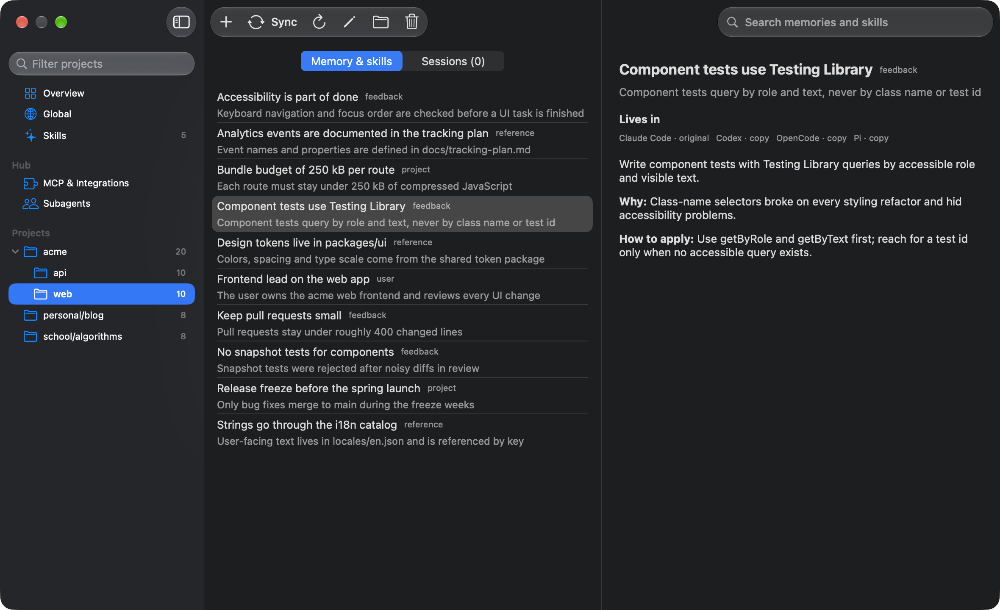

# nativemem

`nativemem` keeps each coding agent's own memory, global instruction sections, skills and chat
sessions in sync with the other agents. There is no shared store: every agent keeps reading its own files, in
its own format, from its own home directory, and the tool translates between them. What one agent
learns about a project shows up in the others without re-teaching. Only the native flow is used:
text is copied verbatim, project scope is preserved, no agent configuration is changed (except the one
`nativemem` MCP entry that `nativemem mcp install` adds) and no LLM is involved.


## Supported agents

| Agent | Memory | Instruction sections (global) | Skills (global) | Chat sessions |
|---|---|---|---|---|
| Claude Code | read and write | `CLAUDE.md` | read and write | read and write |
| Codex | read (generated memories) and receive copies | `AGENTS.md` | read and write | read and write, while the Codex schema checks pass |
| OpenCode | receive copies | `AGENTS.md` | read and write | read and write, while the OpenCode schema checks pass |
| Pi | receive copies | `AGENTS.md` | read and write | read and write |

Hermes has research notes only and no adapter. An agent takes part in a run only when its home
directory exists. Details per agent are in [Current support](#current-support) and in the wiki.

## Install

**macOS.** Download `nativemem-macos-universal.zip` (the desktop app, which embeds the CLI) or
`nativemem-cli-<tag>-macos-universal.tar.gz` (the CLI alone) from the
[Releases](https://github.com/efekurucay/nativemem/releases) page. The macOS artifacts are built on
the maintainer's machine, not in CI. Or build from source.

**Linux.** Download `nativemem-cli-<tag>-linux-x86_64.tar.gz` or `...-linux-aarch64.tar.gz` from
Releases. Linux support is best-effort: the CLI works, `schedule` and notifications are macOS-only.

**Windows.** Not supported yet. The workspace compiles and the core tests pass, but 22 of the 27 CLI
integration tests fail with `Access is denied` (file replacement or locking differs on Windows), so
treat it as unsupported until that is fixed. `schedule` and notifications are macOS-only.

**Verify.** Each release lists SHA-256 checksums in `SHA256SUMS-macos.txt` and `SHA256SUMS-linux.txt`.

**From source.** Needs Rust 1.89 or newer and a C compiler (SQLite is bundled):

```
cargo build --release     # binary: target/release/nativemem
```

## Quick start

These commands read your real agent homes. `sync` only previews until `--apply`; every root can be overridden (see Usage).

```
nativemem status          # entries found per agent, what is skipped and why
nativemem sync            # preview: print the plan, change nothing
nativemem sync --apply    # execute the plan
nativemem schedule install   # macOS: sync every 60 minutes through launchd
nativemem doctor          # compatibility check of each agent's on-disk formats
```

`scripts/demo-home.sh <dir> [path-to-nativemem]` builds a synthetic environment with made-up
agent homes, so you can try every command without touching real data.

## Desktop app (macOS)



A native SwiftUI window onto the CLI: the Overview shows each agent's status and counts, the
sidebar groups memory by project folder and lists skills on their own row, and the detail pane
shows an item (a skill's `SKILL.md`, read-only), which agents hold it and where it came from. A
project folder also lists its chat sessions, newest first, with the transcript shown read-only. It can
preview and apply a sync, create a memory entry or a global instruction section in any agent,
delete an item, and shows what `doctor` reports. The "MCP & Integrations" row manages the MCP hub: its servers, sign-in, import, and which agents use it. The app runs the embedded `nativemem` CLI for every action and holds no sync
logic of its own. See [docs/desktop.md](docs/desktop.md).

Build it with `apps/macos/scripts/bundle.sh` (output: `apps/macos/build/nativemem.app`). The app
is ad-hoc signed, not notarized, so Gatekeeper blocks the first launch of a downloaded copy. Either
right-click the app and choose Open, or run:

```
xattr -dr com.apple.quarantine nativemem.app
```

## Safety

- `sync` is a dry run unless `--apply` is given.
- Every delete or overwrite backs up first to `<state dir>/backups/<UTC timestamp>/<agent>/...`;
  writes are atomic.
- Nothing is written inside a git repository; only agent home directories and the state directory
  are touched. The only agent configuration edited is the `nativemem` MCP entry (`mcp install`).
- Secrets and session bodies are never printed, and the ledger stores ids and hashes, not text.
- A mass-delete guard refuses large removals, and a failed scan aborts the run before planning.
- The compatibility watch (`doctor`) pauses the kinds whose on-disk format an agent update changed.
- Sync never transmits anything over the network. The MCP hub talks only to the MCP servers and
  authorization servers you configured.

## Reference

The sections below describe behaviour in detail.

### Current support

| Agent | Instruction sections (global) | Project memory |
|---|---|---|
| Claude Code | `CLAUDE.md` under the Claude home | `projects/<dir>/memory/*.md`, with a line in that project's `MEMORY.md` |
| Codex | `AGENTS.md` under the Codex home | Originals: blocks of the generated `memories/MEMORY.md` that carry `applies_to: cwd=...`. Replicas: a store under `memories/extensions/nativemem/` and a routing block in `AGENTS.md` |
| OpenCode | `AGENTS.md` under the OpenCode home | A store under `nativemem/memory/` in the OpenCode home (replicas and entries created with `add`) and a routing block in its `AGENTS.md` |
| Pi | `AGENTS.md` under the Pi home | A store under `nativemem/memory/` in the Pi home (replicas and entries created with `add`) and a routing block in its `AGENTS.md` |

Instruction sections and project memory reach all four agents. OpenCode and Pi have no native
memory, so their store holds copies and the entries created there with `add`.
Each adapter declares what it can store, and an item is never planned for an agent that cannot
hold it. An agent takes part in a run only when its home directory exists.

Codex, OpenCode and Pi receive memory the same way: item files, a per-project `MEMORY.md` index
and a `scope.json` in a store, plus a block in the agent's global `AGENTS.md` between
`<!-- nativemem:begin -->` and `<!-- nativemem:end -->` that lists `<cwd> → <index file>` and tells
the agent to read that project's index first. Nothing is written inside a repository, and no agent
configuration file is changed. An edit made to a replica file is written back to the original.

An item file in the store without a marker is an original of that agent: `nativemem add`
creates one in any agent, and a later `sync` copies it to the others. Originals Codex generates
in `memories/MEMORY.md` are read but never edited or deleted by `nativemem`. Entries without a project scope are reported and skipped.

### Skills

A skill is a directory with a top-level `SKILL.md` directly inside an agent's own skills directory
(`<claude home>/skills/<name>/`, `<codex home>/skills/<name>/`, `<opencode home>/skills/<name>/`,
`<pi home>/skills/<name>/`). The directory name is its identity. Skills are mirrored in every
direction like memory: additions, edits and deletions propagate, both sides edited is a conflict,
and every overwrite or removal backs up the whole directory first. A skill is copied as a whole
tree (executable bits kept) into a temporary directory next to the target and swapped in by rename.
Skills are never rewritten or translated.

Dot-directories (`.system`), `synced` (managed by Claude itself), directories without a top-level
`SKILL.md` and plugin caches are left alone. A symlinked skill directory is read through the link
and never written through; when its content must change, the link is replaced by a real directory
(the backup records the link target). `.DS_Store`, `__pycache__/`, `*.pyc`, `.git/` and
`node_modules/` are ignored, symlinks inside a skill are followed only when they resolve inside it,
and skills over 50 MB are skipped; `status` lists both.

On a machine where the copies already exist, identical copies are adopted into the ledger without a
write, and the same name with different content is a conflict that is only reported. Codex and Pi
also read `~/.agents/skills`: a matching copy there counts as already present, so nothing is copied
into that agent, and a copy there with other content is not written over and shows up as a notice.
`doctor` probes each skills directory layout and names such shadowed copies.

### How it works

- **Adapters.** Each agent is an adapter that scans its native store and can write, update and
  remove entries in the agent's own format. The sync engine knows nothing about agent formats.
- **Ledger.** A small SQLite ledger in the state directory records, per entry, the origin and
  the content hash of each side at the last successful sync. It stores ids, hashes and paths,
  not entry text.
- **Three-way decision.** For each entry the engine compares the original, its replicas and the
  ledger: new entries are copied, one-sided edits propagate (including edits made to a replica,
  which are written back to the original), and edits on both sides are reported as conflicts
  and left alone.
- **Deletes propagate, with backups.** Removing an entry on one side removes it on the other
  sides. Every delete or overwrite first copies the old file to the backup directory.
- **Nothing is written inside git repositories.** Only agent home directories and the state
  directory are touched.

### Chat sessions

Sessions travel between Claude Code, Codex and Pi in every direction. A session is copied once, as a
resumable transcript in the target agent's own format, with each tool call and its result shown
as one readable text block (`Tool: <name>`, the command or input, `Result:` and the output, both
cut when long) and thinking dropped. The copy is refreshed only while you have not touched it and
the original grew; once you continue it in its own agent it is left alone. A copy you delete is not recreated, edits
never flow back, and deleting or pruning an original never removes copies. Copies carry a marker
(Claude Code: an extra `nativemem_origin` key on the lines the tool writes; Pi: a
`nativemem-origin` custom entry), so a lost ledger cannot turn a copy into an original. Sessions
Codex imported are never read as Codex originals.

Every session of every age and kind is synced by default, so each agent's resume list shows the
same sessions in the same order (a copy takes its original's modification time and title). Limits
are opt-in: `--session-days <N>` (env `NATIVEMEM_SESSION_DAYS`) keeps only sessions modified in the
last N days, `--exclude-automated-sessions` leaves out headless runs and sub-agent threads, and
`--no-sessions` turns session sync off. A session needs at least one user turn. Sources over
200 MB and sessions without a working directory are skipped and listed by `status`, which also
counts automated sessions per agent (`automated_sessions` in `--json`).

A copy written by an older version of the tool is rewritten once when it is still unmodified.
Pi copies open with Pi's own default model, without a model-restore warning.

Claude Code deletes transcripts older than `cleanupPeriodDays` (default 30, in its `settings.json`)
by modification time, and a copy keeps its original's time, so sessions older than that retention
minus a day are not copied into Claude Code; `doctor` and `status` print a notice about it when the
default applies and such sessions exist. Nothing in Claude's settings is changed.

Codex copies are rollout files under `sessions/` shaped like what Codex's own importer writes; for a
Claude session this tool also adds the matching record to Codex's import ledger so Codex does not
import it again, and a session Codex already imported counts as its copy. Codex lists threads from
its state database, so each copy also gets one row in the `threads` table of `state_<n>.sqlite`,
shaped like the row Codex's importer inserts. The writes run only while the `codex.state_db` and
`codex.threads_columns` checks of `nativemem doctor` pass; it is inserted or refreshed for copies
this tool wrote, a copy that lost its row gets it back on the next run, and no row is ever deleted or
changed for a thread Codex made. Before the first write of a run the database is copied with SQLite's
online backup to `<state dir>/backups/<stamp>/codex/` (the five newest copies are kept); a database
that is locked is skipped and the row follows on the next run. That Codex lists and opens a copy is
`[UNVERIFIED]` until you run `codex resume` in the project folder and see it.

OpenCode sessions live in `opencode.db` (SQLite). They are read and copied whenever the file exists and
the `opencode.session_schema` and `opencode.version` checks of `nativemem doctor` pass: per copy one `session_v2` row, its
`session_message` rows, the `event_sequence` row and, when the folder has none, a `project` row, in
one transaction after a consistent backup of the database to `<state dir>/backups/<stamp>/opencode/`
(the five newest are kept). Rows OpenCode made are never changed and no row is deleted; a locked
database is skipped and written on the next run. Copies carry a `nativemem_origin` key inside each
message's JSON, which OpenCode does not show. Whether the running OpenCode service needs a restart
to list new copies and whether `opencode -c` opens them is `[UNVERIFIED]`.

Automated sessions are recognised by structure only: a Claude Code transcript whose first line has
an `entrypoint` starting with `sdk`; a Codex rollout that is a sub-agent thread (`source` an
object, `parent_thread_id` or `thread_source: subagent`), a headless `exec` run (`source: exec` or
originator `codex_exec`), or a thread started by Claude Code (originator `Claude Code`); an OpenCode sub-agent session (`parent_id` set, never copied). A session
without a recognised marker counts as interactive. Pi has no such marker, and neither has a headless `opencode run`.

### Usage

Build the CLI with `cargo build --release`; the binary is `target/release/nativemem`.

```
nativemem status                      # entries found per agent, what is skipped and why
nativemem items [--json]              # list every entry in the native stores
nativemem items --kind session        # chat sessions (never with bodies)
nativemem session show --agent <id> --id <native id> [--json]   # one session's transcript, read-only
nativemem items --kind skill          # skills (never with file contents)
nativemem skill show --agent <id> --name <skill> [--json]   # the SKILL.md text
nativemem sync                        # dry run: print the plan, change nothing
nativemem sync --apply                # execute the plan
nativemem delete --agent claude|codex|opencode|pi --id <native id>
nativemem add --agent claude|codex|opencode|pi --kind memory --project <abs path> < entry.json
nativemem add --agent claude|codex|opencode|pi --kind instruction < entry.json
nativemem edit --agent claude --id <native id> < entry.json
nativemem doctor [--json] [--agent <id>] [--accept <agent>] [--prompt <agent>]
nativemem mcp list|add|edit|remove|enable|disable [--json]   # the MCP hub's servers (hub.toml)
nativemem mcp set-secret <id> < value            # keychain secret behind `secret:<id>` in hub.toml
nativemem mcp import [--apply] [--json]          # read the agents' MCP servers into the hub
nativemem mcp test <name> [--json]               # connect to one server and list its tools
nativemem mcp login|logout <name> [--json]       # sign in to an OAuth server once, for every agent
nativemem mcp install|uninstall|status [--agent <id>] [--json]   # the one `nativemem` MCP entry in each agent
nativemem mcp serve                              # the hub itself: a stdio MCP server for an agent
nativemem schedule install [--every <minutes>]
nativemem schedule status [--json]
nativemem schedule uninstall
```

Global options: `--claude-home`, `--codex-home`, `--opencode-home`, `--opencode-data-home`, `--pi-home`, `--state-dir`,
`--session-days`, `--exclude-automated-sessions`, `--no-sessions` (env `NATIVEMEM_CLAUDE_HOME`, `NATIVEMEM_CODEX_HOME`, `NATIVEMEM_OPENCODE_HOME`, `NATIVEMEM_OPENCODE_DATA_HOME`,
`NATIVEMEM_PI_HOME`, `NATIVEMEM_STATE_DIR`, `NATIVEMEM_SESSION_DAYS`). Defaults are `~/.claude` (or `CLAUDE_CONFIG_DIR`),
`~/.codex` (or `CODEX_HOME`), `~/.config/opencode` (or `OPENCODE_CONFIG_DIR`), `~/.local/share/opencode` for the OpenCode database (or `$XDG_DATA_HOME/opencode`), `~/.pi/agent`
(or `PI_CODING_AGENT_DIR`) and `~/.nativemem`. `--json` prints one JSON
document, including errors as `{"error": ..., "code": ...}`.

`edit` reads `{"name", "description", "category", "body"}` from stdin and rewrites the original
entry only; copies are edited through their original. `add` reads the same document and creates
a new original in that agent: a project memory entry (`--kind memory`, with the absolute
`--project`) or a global instruction section (`--kind instruction`, where `description` is the
heading and `category` is ignored). It answers `exists` when the entry is already there and
`not_installed` when the agent has no home directory. `delete`, `add` and `edit` do not sync (the
next `sync` copies a new entry to the other agents) and `delete` and `edit` refuse
session ids with code `unsupported`. `status` shows sessions per agent apart from the other
entries (`sessions` in `--json`) and skills likewise (`skills`). `edit` refuses skill ids with
code `unsupported`: skills are edited as files.

Exit codes: 0 success, 2 when conflicts or skipped writes remain, 1 on error. `doctor` exits 3
when an agent needs action.

#### MCP hub (`mcp`)

`nativemem mcp serve` is one local MCP server that holds the real MCP servers (stdio or HTTP) and
their secrets in one place and exposes their tools, named `<server>__<tool>`, behind a single
connection; `nativemem_status` reports which servers connected. Servers live in
`<state dir>/hub.toml`; any value can be `secret:<id>`, kept in the OS keychain and never printed.
`mcp import` reads the four agents' MCP entries (read-only) and moves env and header values into the
keychain. `mcp login <name>` signs in to an OAuth server once (authorization code with PKCE, loopback
redirect, browser); the hub keeps and refreshes the tokens for all agents. `mcp install` registers the hub in
Claude Code, Codex, OpenCode and Pi as one entry named `nativemem` in each agent's own MCP
configuration (`.claude.json`, `config.toml`, `opencode.json(c)`, `mcp.json`); it edits only that entry,
keeps every other byte, backs up first and never writes a file that does not parse. `mcp uninstall`
removes it. While the hub cannot start, the agents have no MCP tools from it. Details:
[wiki/architecture/hub.md](wiki/architecture/hub.md), [wiki/decisions/mcp-hub.md](wiki/decisions/mcp-hub.md).

#### Compatibility watch (`doctor`)

The agents update themselves and `nativemem` depends on their on-disk formats. Every adapter
compares what it finds on disk with the formats it was written against (key sets, column
signatures, type sets, small integers; never message text) and reports a status per agent:
`ok`, `updated` (the version changed within the last 3 days and every check passes),
`action_required` (a check fails) or `not_installed`.

- Before every `sync`, the kinds protected by a failing check are paused for that agent
  (`codex: sessions paused, run nativemem doctor`); other agents and other kinds keep syncing.
- `doctor` prints version, status, failing checks with expected and observed descriptors and the
  paused kinds. `--prompt <agent>` prints a prompt for a coding agent working in this repository
  (repository: `NATIVEMEM_REPO`, else the directory the binary was built from). `--accept <agent>`
  records the current observed values of that agent's failing checks as reviewed, so syncing
  resumes; a later, different observation needs a new review.
- `status` prints one `warning:` line per agent that is not `ok`; `status --json` adds
  `compat`.
- State lives in `<state dir>/compat.json` (versions, reviewed values, last notified status),
  written only by `doctor` and `sync --apply`.
- `sync --apply --notify` shows a macOS notification once per status change (agent and status
  only); `schedule install` adds `--notify` to the job. `NATIVEMEM_NOTIFY_FILE` appends the text
  to a file instead of notifying.

#### Scheduled sync (macOS)

`schedule install` copies the running executable to `<state dir>/bin/nativemem`, writes
`~/Library/LaunchAgents/dev.nativemem.sync.plist` and loads it with `launchctl`. The job runs
`sync --apply --notify` every 60 minutes by default (`--every`, minimum 5) at low priority and logs to
`<state dir>/sync.log`. Roots given by flag or environment variable are passed to the job.
Re-running `install` updates the job; `uninstall` removes it and leaves the state directory.
`--launch-agents-dir` (env `NATIVEMEM_LAUNCH_AGENTS_DIR`) changes the plist location. On other
platforms these commands fail with `unsupported_platform`.

Writing runs (`sync --apply`, `delete`, `add`, `edit`, and the `mcp` commands that write) take an exclusive lock on
`<state dir>/sync.lock` (`mcp login` and `logout` take `<state dir>/hub-oauth.lock` instead). If another run holds it, the command fails with code `busy` and
writes nothing. `status`, `items` and dry-run `sync` do not lock.

### Safety details

- `sync` is a dry run unless `--apply` is given.
- Backups go to `<state dir>/backups/<UTC timestamp>/<agent>/<relative path>`.
- Mass-delete guard: if a plan removes more than 10 entries, or more than 3 entries and more
  than 20% of the ledger's items, `sync --apply` refuses unless `--allow-mass-delete` is given.
- If an agent's scan fails, the run aborts before planning, so a failed read never looks like a
  mass deletion.
- Writes are atomic: temp file in the same directory, fsync, rename.

### Not yet

- Agents other than Claude Code, Codex, OpenCode and Pi.
- Resource kinds other than memory entries, instruction sections, skills and chat sessions (MCP config).
- Sessions for Hermes.
- Memory maintenance: classification, promotion to global scope, summarising, stale cleanup.
- Global-scope Claude entries and writing back to Codex originals.

## Documentation

- [wiki/README.md](wiki/README.md): the knowledge base (architecture, agents, kinds, guides, runbooks)
- [docs/design.md](docs/design.md): design and build plan
- [docs/desktop.md](docs/desktop.md): desktop app and the CLI JSON contract
- [wiki/guides/release.md](wiki/guides/release.md): cutting a release; the release notes are built from commit subjects of the form `type(scope): summary`

## Contributing and security

See [CONTRIBUTING.md](CONTRIBUTING.md) and [SECURITY.md](SECURITY.md).

