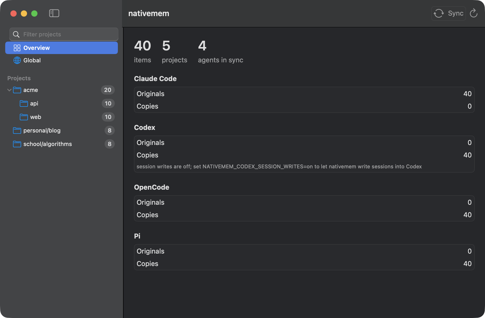
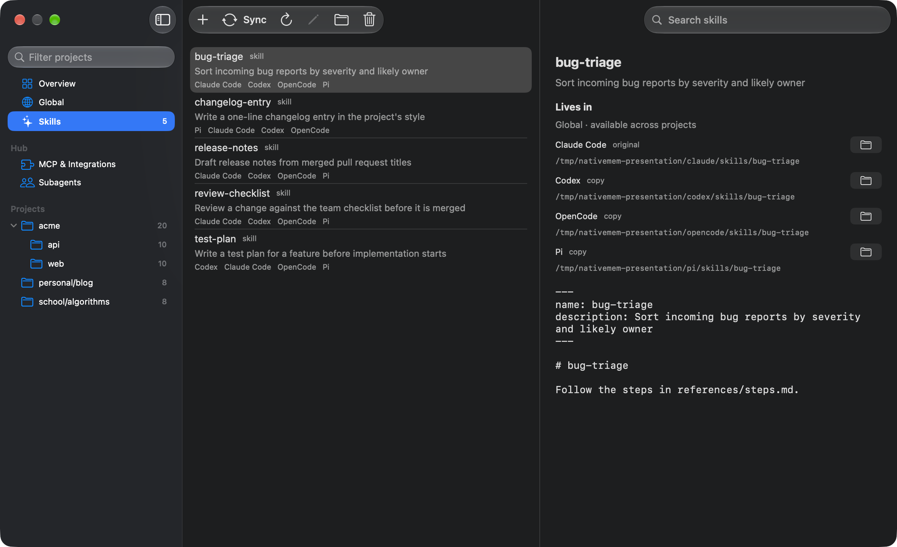

<p align="center">
  
</p>

<h1 align="center">Change the agent. Keep the context.</h1>

<p align="center">
  Native memory sync for <strong>Claude Code, Codex, OpenCode and Pi.</strong><br>
  A local Rust CLI, a native Mac app, and an optional MCP hub.
</p>

<p align="center">
  <a href="https://github.com/efekurucay/nativemem/actions/workflows/ci.yml"></a>
  <a href="LICENSE"></a>
  
</p>

<p align="center">
  <a href="https://efekurucay.com/nativemem/">Website</a> ·
  <a href="#get-started">Get started</a> ·
  <a href="#the-desktop-app">The app</a> ·
  <a href="wiki/README.md">Technical wiki</a> ·
  <a href="CONTRIBUTING.md">Contribute</a> ·
  <a href="https://github.com/efekurucay/nativemem/issues">Report a bug</a>
</p>



## Explain it once

You switch coding agents. Your project's context shouldn't disappear at the handoff.

**nativemem** translates between the files the agents already read. Each agent keeps its own native
memory, instructions, skills and session copies. There is no shared memory service to adopt, and no
LLM in the sync loop. The ledger records IDs, hashes and paths—not a second copy of your memory.

- **Project memory & global instructions.** Create an entry in any supported agent. Preview how it
  reaches the others. One-sided edits propagate; simultaneous edits become conflicts to review.
- **Skills, with their files.** Mirror whole skill directories, not just `SKILL.md`. Global skills
  have their own list; project skills appear in the project tree with exact locations for each copy.
- **Conversation handoffs.** Copy session snapshots into another agent's native format. Readable
  text and tool activity travel; provider-bound thinking, signatures and images do not.
- **One optional MCP hub.** Connect your integrations once, keep their secrets in the OS keychain,
  and register the hub in each agent. OAuth sign-in belongs to the hub, not a copied token cache.
- **Subagents you define.** Choose a harness, a model and instructions. Agents connected to the hub
  can call that subagent as a tool. Model calls use the harness's provider and billing.

## Get started

### Download for Mac

**[Download for Mac ↓](https://github.com/efekurucay/nativemem/releases/latest/download/nativemem-macos-universal.dmg)**

macOS 14+ · Apple silicon & Intel · Universal DMG

1. Open the DMG and drag **nativemem.app** to **Applications**.
2. Open it from Applications. The app embeds the CLI; no Rust installation is needed.
3. If macOS blocks the first launch, use **System Settings → Privacy & Security → Open Anyway**
   for nativemem. The app is ad-hoc signed, not notarized; only approve a download you trust.

[ZIP alternative](https://github.com/efekurucay/nativemem/releases/latest/download/nativemem-macos-universal.zip)
· [Release notes and SHA-256 checksums](https://github.com/efekurucay/nativemem/releases/latest)
· [Linux and standalone CLI downloads](https://github.com/efekurucay/nativemem/releases/latest)

**Early software:** preview changes before applying them. File sync does not need an account or an API key.

### CLI from source

Needs current stable Rust and a C compiler (SQLite is bundled).

```sh
git clone https://github.com/efekurucay/nativemem.git
cd nativemem
cargo install --path crates/cli --locked
```

The command installs into `~/.cargo/bin`; add that directory to `PATH` if your shell cannot find it.

```sh
nativemem doctor          # check compatibility with installed agents
nativemem status          # see what each agent holds
nativemem sync            # preview; no content writes
nativemem sync --apply    # apply the plan, with backups
```

These commands use your actual agent homes. **Read the preview before applying.** Memory,
instruction and skill deletions propagate. Session sync can write Codex and OpenCode database
rows while their compatibility checks pass. Use `--no-sessions` to leave sessions out.

Prefer a sandbox first? Generate synthetic agent homes without touching your own:

```sh
cargo build --release --locked -p nativemem-cli
scripts/demo-home.sh "$(mktemp -d)" "$PWD/target/release/nativemem"
```

The script prints explicit roots for subsequent commands. Always use those roots for testing.

### The desktop app

A native SwiftUI interface to the same CLI. Browse projects, create or edit memory, inspect a session,
locate a skill, manage integrations, or try a subagent. Sync always starts with a preview.



Build on **macOS 14+**, with Xcode Command Line Tools and Swift 6:

```sh
cargo build --release --locked -p nativemem-cli
apps/macos/scripts/bundle.sh
open apps/macos/build/nativemem.app
```

These build steps are optional: the [Mac download](#download-for-mac) already includes the app and CLI.
The bundle can be moved to Applications. It is ad-hoc signed, not notarized; downloaded builds may
require explicit first-launch approval in System Settings → Privacy & Security.
The desktop app does not run on Windows or Linux.

## What works where

| Agent | Project memory | Global instructions | Global skills | Project skills | Session snapshots |
|---|---|---|---|---|---|
| Claude Code | Read / write | `CLAUDE.md` | Read / write | `.claude/skills/` | Read / write |
| Codex | Read generated memory; create / receive entries in its nativemem store | `AGENTS.md` | Read / write | Not implemented | Read / write¹ |
| OpenCode | Create / receive entries in its nativemem store | `AGENTS.md` | Read / write | `.opencode/skills/` | Read / write¹ |
| Pi | Create / receive entries in its nativemem store | `AGENTS.md` | Read / write | `.pi/skills/` | Read / write |

¹ Database writers are gated by schema checks and back up the database before writing their own
rows. Native session listing and resume still need agent-by-agent verification; see the
[verification checklist](wiki/guides/verify-with-real-agents.md). Session conversion is not lossless.

Project skills are discovered in known projects, not by crawling every repository on disk.
Git tracking and `.gitignore` policy are yours; nativemem does not edit them.
Hermes has [research notes](wiki/agents/hermes.md), not an adapter.

**Platforms:** macOS is the primary platform. Linux CLI support is best-effort and runs through CI.
Windows is not supported. Scheduled sync (`launchd`) and desktop notifications are macOS-only.

## Useful commands

```sh
# Browse without dumping session bodies or skill file contents
nativemem items --kind memory --json
nativemem items --kind skill --json
nativemem items --kind session --json

# Read the desktop's items, status and compatibility together, without loading transcripts
nativemem --no-sessions snapshot --json

# Read exactly one skill, including a project skill, by the ID from items
nativemem skill show --agent claude --id 'skill:<project-key>/<name>'

# Create project memory or a global instruction section from stdin JSON
nativemem add --agent pi --kind memory --project /absolute/project < entry.json
nativemem add --agent pi --kind instruction < entry.json

# Optional: run file sync every hour on macOS
nativemem schedule install
nativemem schedule status
nativemem schedule uninstall
```

Entry JSON contains `name`, `description`, `category` (or `null`) and Markdown `body`.
For a global instruction, `description` is the section heading. Skills are edited as files.
Use `nativemem --help` and the subcommand's `--help` for the full CLI.

The desktop starts with one fresh snapshot. Sessions, MCP connections and subagent definitions load
when you open their screens. Reload refreshes the current screen and invalidates deferred data;
sync always reads fresh native data. See [the loading contract](wiki/architecture/overview.md#desktop-app)
and [synthetic performance measurements](CONTRIBUTING.md#startup-performance).

### MCP integrations & subagents

The hub is optional and separate from file sync. It connects to the MCP servers you configure;
it does not copy another agent's credentials. Each connected agent starts a stdio hub process.

```sh
nativemem mcp import          # preview existing server configurations
nativemem mcp import --apply  # import into hub.toml; source entries stay intact
nativemem mcp login <server>  # OAuth sign-in, when the server uses it
nativemem mcp install         # register one nativemem entry in each installed agent
nativemem mcp status
nativemem subagent list
```

Import leaves each agent's direct server entries in place, so review duplicate tool exposure before
using both. Environment expansions and unsupported config fields are reported as warnings.
The app has dedicated **MCP & Integrations** and **Subagents** screens.
[Hub setup, secret handling and subagent configuration →](wiki/architecture/hub.md)

## Predictable, not magical

- **Preview by default.** `sync` plans; `sync --apply` writes. Conflicts are left alone.
- **Back up before replacing.** Files and skill trees are backed up under the state directory,
  normally `~/.nativemem/backups/`. Skill copies use a staged directory swap.
- **Keep scope.** Memory stays with its project. Project skills write only their agent-specific
  skill directories inside that project; other project files and `.gitignore` are not edited.
- **Check formats.** `doctor` pauses affected kinds when an agent's format changes. It is not a
  guarantee of native resume behavior or of compatibility with every agent version.
- **Treat sessions differently.** Copies refresh only while untouched. Continue a copy and it is
  left alone. Session deletions never propagate and edits never flow back.
- **Keep sync local.** File sync uses no network or model calls. The optional hub and its subagents
  use the connections, permissions and credentials you configure.

Read the [sync architecture](wiki/architecture/overview.md), [safety rules](wiki/architecture/safety.md)
and [per-agent format notes](wiki/agents/claude-code.md) before a production rollout.
Report vulnerabilities privately through [SECURITY.md](SECURITY.md).

## Build with us

Small, reproducible reports are useful: agent version, failing check, expected behavior and a
**redacted** fixture. Don't upload real memories, conversations or credentials.

```sh
cargo test --workspace
cargo clippy --workspace --all-targets -- -D warnings
cargo fmt --all -- --check
(cd apps/macos && swift test)
```

Tests use temporary roots. Never test the CLI or desktop app against real agent homes.
[CONTRIBUTING.md](CONTRIBUTING.md) covers the workflow;
[wiki/README.md](wiki/README.md) is the technical map;
[site/](site/) contains the static landing page and its browser tests.

MIT licensed. Made by [Yahya Efe Kuruçay](https://efekurucay.com/).
